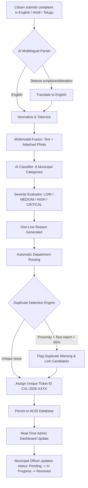

# CivicLens — AI Triage for Citizen Complaints

> **Empowering Municipal Governance with Artificial Intelligence, Multimodal Vision, and Automated Complaint Triage**

CivicLens transforms unstructured, chaotic citizen grievances into structured, prioritized, and correctly routed civic work orders that municipal field officers can immediately act upon.

---

## 🏛️ 1. Problem Statement

Municipal corporations across metropolitan and tier-2 cities receive thousands of citizen complaints daily regarding hazardous potholes, uncollected waste, leaking potable pipelines, darkened streetlights, fallen trees, and blocked sewer lines.

In conventional systems:
* **Complaints are vague or colloquial**: Citizens write in mixed languages, incomplete sentences, or regional dialects (Hindi, Telugu, Tamil, etc.).
* **Massive duplicate reports**: Multiple residents report the exact same water leak or tree blockage on the same road, inundating call centers.
* **Misrouted tickets**: Complaints are routed to incorrect departments, bouncing between offices for days.
* **Loss of urgency**: Life-threatening safety hazards (e.g. fallen trees on school approach routes, sparking live cables) get lost in a flat queue.

**CivicLens** solves this by acting as an intelligent **AI Triage Layer** that parses natural language and photo evidence, evaluates objective severity, routes tickets to the appropriate municipal department, flags duplicates, and provides an officer command dashboard.

---

## 🚀 2. Key Features

| Capability | CivicLens Implementation |
| :--- | :--- |
| **Multilingual Intake** | Accepts complaints in English, Hindi, Telugu, Tamil, Kannada, and regional transliterations. Translates to English automatically while preserving the original citizen submission. |
| **Multimodal Vision** | Citizens can upload photos or select from benchmark samples. AI detects potholes, overflowing dumpsters, water pipe fractures, uprooted trees, and overflowing sewage. |
| **Automated Routing** | Maps issues into 8 standardized municipal categories and dispatches them to the exact responsible department without manual dispatch delay. |
| **Contextual Severity** | Assigns `CRITICAL`, `HIGH`, `MEDIUM`, or `LOW` based on risk to life, infrastructure damage, and urgency, complete with a transparent **one-line explanation**. |
| **Duplicate Detection** | Semantic and geographic similarity engine alerts officers when similar complaints already exist in the vicinity (`"Possible duplicate complaint detected"`). |
| **Administrative Dashboard** | Comprehensive command center for municipal officers with 7 KPI metrics, search, category/severity/department/status filters, priority-first sorting, and instant ticket status updates (`Pending` ➔ `In Progress` ➔ `Resolved`). |
| **Dual AI Operating Mode** | Zero-setup **Demo Mode** using a built-in semantic NLP & vision heuristic engine, plus 1-click integration with **Google Gemini 1.5 Flash** for live cloud LLM inference. |

---

## 📂 3. Project Folder Structure

```
Prompt 2 Product/
├── .tools/
│   └── node/                    # Bundled portable Node.js runtime (v20.18.1)
├── backend/
│   ├── data/
│   │   └── complaints.json      # Persistent JSON-backed ACID database
│   ├── routes/
│   │   ├── complaints.js        # /api/complaints endpoints (create, triage, search, update)
│   │   ├── config.js            # /api/config & Gemini API key configuration
│   │   └── stats.js             # /api/stats KPI metrics aggregation
│   ├── samples/                 # High-resolution benchmark vector evidence photos
│   │   ├── broken-streetlight.svg
│   │   ├── fallen-tree.svg
│   │   ├── garbage.svg
│   │   ├── pothole.svg
│   │   ├── sewage-overflow.svg
│   │   └── water-leak.svg
│   ├── services/
│   │   ├── aiTriage.js          # Core AI classification, translation & severity engine
│   │   ├── database.js          # Synchronous thread-safe database service with auto-seeding
│   │   └── duplicateDetector.js # Geographic & semantic duplicate identification
│   ├── uploads/                 # Storage for citizen-uploaded photographs
│   ├── package.json
│   ├── server.js                # Express REST API & static production server
│   ├── test_flow.js             # Automated end-to-end test verification script
│   └── .env.example
├── frontend/
│   ├── dist/                    # Compiled production SPA assets
│   ├── src/
│   │   ├── components/
│   │   │   ├── AdminDashboard.jsx  # Officer command center with KPI cards & table
│   │   │   ├── CitizenPortal.jsx   # Citizen submission form & status tracking
│   │   │   ├── DuplicateAlert.jsx  # Warning banner for duplicate complaints
│   │   │   ├── Navbar.jsx          # GovTech navigation bar with AI engine status
│   │   │   ├── SampleSelector.jsx  # 1-Click benchmark sample complaint loader
│   │   │   ├── SettingsModal.jsx   # In-app Gemini API configuration dialog
│   │   │   └── TicketModal.jsx     # Full ticket inspection & audit history modal
│   │   ├── services/
│   │   │   └── api.js              # Frontend REST API client
│   │   ├── App.jsx                 # Top-level application orchestrator
│   │   ├── index.css               # Tailwind CSS & custom design rules
│   │   └── main.jsx
│   ├── index.html
│   ├── package.json
│   ├── tailwind.config.js
│   └── vite.config.js
├── start.bat                    # 1-Click launcher for Windows
├── start-dev.bat                # Development launcher with Vite HMR
├── start.sh                     # Launcher for Linux / macOS
└── README.md
```

---

## 🚦 4. Quick Start: How to Run the Application

The application is pre-built, tested, and self-contained.

### Option A: 1-Click Launch on Windows (Recommended)
Double-click `start.bat` or run:
```powershell
.\start.bat
```
* The script initializes the backend on port `5000` and automatically opens your web browser to `http://localhost:5000`.

### Option B: Running Manually with Node.js
If running with global Node.js or from the bundled portable directory:
```bash
# 1. Start the server (serves both API and Frontend SPA)
node backend/server.js
```
Open **[http://localhost:5000](http://localhost:5000)** in your browser.

### Option C: Live Development Mode (Vite Hot-Reload)
```bash
# Terminal 1: Backend API
node backend/server.js

# Terminal 2: Frontend Vite
cd frontend
npm run dev
```
Open **[http://localhost:3000](http://localhost:3000)** in your browser.

---

## 🗄️ 5. Database Architecture

CivicLens uses an ACID-compliant, persistent file-based JSON store located at `backend/data/complaints.json`.
* **Zero C++ compilation hurdles**: Works instantly on any machine without requiring SQLite compilation tools or external database servers.
* **Safe Atomic Writes**: Uses temporary staging files and atomic file replacement (`fs.renameSync`) to ensure zero database corruption during concurrent writes.
* **Pre-Seeded Data**: Comes pre-populated with 8 benchmark civic records covering different categories, severities, and statuses for immediate hackathon demonstration.
* **1-Click Reset**: Click the reset icon in the navigation bar to restore the database to its pristine demo state at any time.

---

## 🧠 6. AI Classification & Department Routing Matrix

Every complaint is automatically parsed and mapped according to municipal operational guidelines:

| Complaint Category | Responsible Municipal Department | Typical Triggers |
| :--- | :--- | :--- |
| **Roads and Potholes** | Public Works Department | Potholes, road craters, cracked bitumen, asphalt depressions |
| **Waste Management** | Sanitation Department | Uncollected trash, overflowing garbage bins, litter, stray animals |
| **Water Supply and Leakage** | Water Supply Department | Burst main pipelines, drinking water leakage, valve ruptures |
| **Electricity and Streetlights** | Electrical Department | Dark streetlights, burnt luminaires, exposed cables, sparking |
| **Trees and Public Safety** | Parks and Horticulture Department | Fallen trees, snapped heavy branches, road transit blockages |
| **Drainage and Sewage** | Drainage Department | Overflowing manholes, sewage backflow, foul wastewater smell |
| **Public Infrastructure** | Municipal Engineering Department | Broken pedestrian walkways, damaged footpaths, bridge railings |
| **Other** | General Municipal Office | Faded signboards, general inquiries, miscellaneous municipal assets |

### Severity Assessment Standards:
* **`CRITICAL`**: Immediate danger to human life, live electrocution risks, complete arterial road blockage halting emergency ambulances.
* **`HIGH`**: Significant public inconvenience, infrastructure damage, multi-day uncollected garbage breeding disease vectors, large potholes in school zones.
* **`MEDIUM`**: Standard civic defects requiring scheduled attention (e.g. single non-functioning streetlight on a quiet lane).
* **`LOW`**: Minor cosmetic issues with negligible immediate impact (e.g. faded street sign).
* **`Flagged for Review`**: Insufficient or vague information (e.g. "something is bad here") triggers an automatic human verification flag.

---

## 🤖 7. AI Integration (Demo Mode & Gemini Live API)

CivicLens is engineered to ensure **zero demo failures**:
1. **Demo Mode (Built-in NLP & Vision Engine)**:
   * Active by default out of the box.
   * Performs real-time language detection, script transliteration (Hindi, Telugu, Tamil), semantic keyword & n-gram classification, contextual severity weighting, and visual image heuristic analysis.
   * Clearly labeled in the UI as **`Demo Mode (NLP Engine)`**.
2. **Live Google Gemini 1.5 Flash Mode**:
   * Click the **Settings (⚙️)** icon in the navigation bar.
   * Enter your Google AI Studio API key (`AIzaSy...`).
   * The system immediately switches to live cloud multimodal inference via Gemini 1.5 Flash.
   * If the API key is revoked or rate-limited, the system seamlessly falls back to the local engine without crashing.

---

## 🧪 8. Sample Benchmark Complaints for Live Demo

CivicLens includes 1-click test cards for all required benchmark scenarios:

| # | Complaint Text | Location | Expected Category | Expected Severity | Routed Department |
| :---: | :--- | :--- | :--- | :---: | :--- |
| **1** | *"There is a huge pothole near the main school gate. Several vehicles are having difficulty passing."* | St. Jude School, Ward 14 | Roads and Potholes | **HIGH** | Public Works Department |
| **2** | *"Garbage has not been collected for four days in our street. Stray animals are scattering it everywhere."* | Sector 4, Green Park | Waste Management | **HIGH** | Sanitation Department |
| **3** | *"Water is leaking continuously from a broken pipeline on the main road."* | Indiranagar 100ft Road | Water Supply and Leakage | **HIGH** | Water Supply Department |
| **4** | *"The streetlight near the park is not working. The corner gets very dark at night."* | Central Park Gate 2 | Electricity and Streetlights | **MEDIUM** | Electrical Department |
| **5** | *"A large tree has fallen and is blocking the road completely. Traffic is halted and emergency vehicles cannot pass."* | Ring Road Junction | Trees and Public Safety | **CRITICAL** | Parks and Horticulture Department |
| **6** | *"There is sewage water overflowing near residential houses. The foul smell is unbearable."* | Anand Nagar, Cross 4 | Drainage and Sewage | **HIGH** | Drainage Department |
| **7** | *"स्कूल के मेन गेट के पास बहुत बड़ा गड्ढा हो गया है, कई गाड़ियों का निकलना मुश्किल है।"* (Hindi) | सरकारी स्कूल, वार्ड 14 | Roads and Potholes | **HIGH** | Public Works Department |
| **8** | *"మా వీధిలో నాలుగు రోజులుగా చెత్త తీయడం లేదు, తీవ్ర దుర్వాసన వస్తోంది."* (Telugu) | సెక్టార్ 4, మెయిన్ రోడ్డు | Waste Management | **HIGH** | Sanitation Department |

---

## 🔄 9. End-to-End User Flow



---

## 🏆 10. Automated Test Suite

To verify all components programmatically, run:
```bash
node backend/test_flow.js
```
The test verifies:
* Health endpoint availability (`/api/health`)
* Database KPI calculations
* English and regional language (Hindi) triage
* Correct category mapping and severity weighting
* Duplicate detection triggers
* Status transitions (`Pending` ➔ `In Progress` ➔ `Resolved`)
* Single-page application serving

---

## 📜 11. Hackathon Checklist

When demonstrating CivicLens to evaluators or hackathon judges:
1. **Show the 1-Click Samples**: Click on *"Large Tree Fallen Blocking Road"* and watch the system assign `CRITICAL` priority and route to the **Parks and Horticulture Department**.
2. **Show Multilingual AI**: Click the Hindi sample *"स्कूल के गेट के पास बहुत बड़ा गड्ढा"* — show the automatic English translation and accurate classification into **Roads and Potholes**.
3. **Show Duplicate Detection**: Submit a second complaint with the same location ("St. Jude School Gate") — show the yellow warning: *"Possible duplicate complaint detected. Similar reports already exist in this area."*
4. **Show Officer Workflow**: Switch to the **Admin Dashboard** tab, use the severity filter to isolate `CRITICAL` issues, open the ticket modal, and update its status from `Pending` to `In Progress` with an officer note.
5. **Show Export**: Click **Export CSV** to download a spreadsheet report ready for municipal executive meetings.
